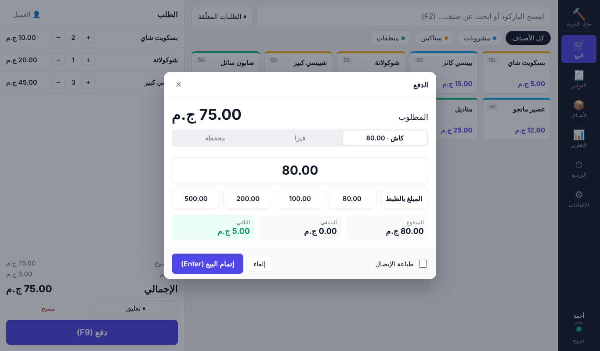
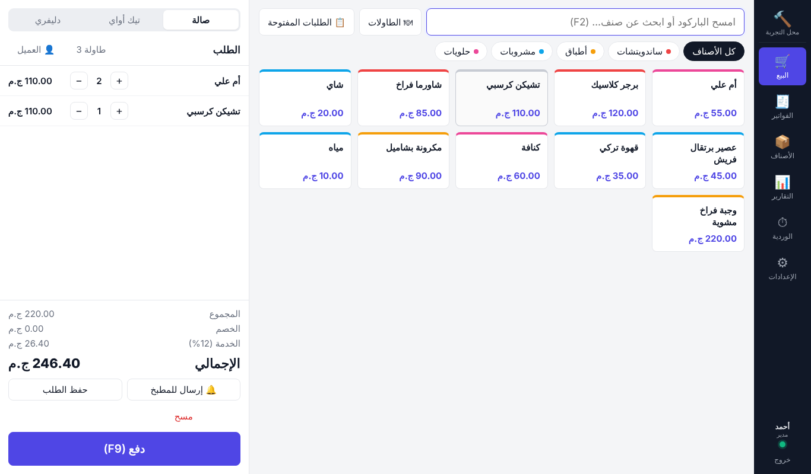
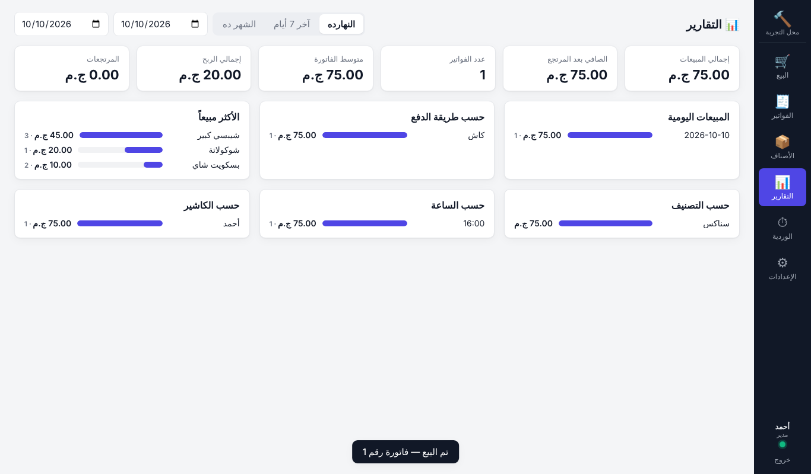
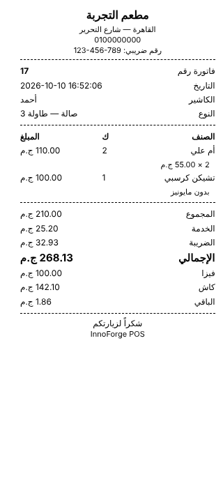

# 🧾 InnoForge POS

> 📘 **Full bilingual guide (Arabic / English):** [`docs/guide.html`](docs/guide.html) — selling & activating licenses, and using every feature.

**An offline desktop point-of-sale for shops, bookstores and restaurants.** It's the first ready-made system in InnoForge.

Everything runs locally: data lives in a SQLite file on the machine, so you don't need internet, a server, or a subscription.



## Features

| | Shop / Supermarket | Bookstore | Restaurant / Café |
|---|:-:|:-:|:-:|
| Fast sales screen, barcode scanner support (`3*barcode` for qty) | ✅ | ✅ | ✅ |
| Categories, products, cost & price | ✅ | ✅ | ✅ |
| Stock tracking, purchases, count adjustments, low-stock list | ✅ | ✅ | optional |
| ISBN, author, publisher fields | | ✅ | |
| Held / parked carts | ✅ | ✅ | |
| Tables, dine-in / takeaway / delivery | | | ✅ |
| Kitchen tickets (only new items are sent) | | | ✅ |
| Service charge on dine-in | | | ✅ |

**Shared core**

- Payments: cash, card, and wallet, with split payments and automatic change.
- Discounts per line or on the whole invoice (amount or %).
- Tax, either inclusive or added on top.
- 58 / 80 mm thermal receipts, with optional silent printing and a separate kitchen printer.
- Shifts: opening float, expected vs. counted cash, and a printable Z-report.
- Returns (partial or full) that restock items and refund proportionally.
- Reports: sales, net, profit, and breakdowns by payment method, day, hour, category, product, cashier and order type.
- **Purchasing**: suppliers, purchase invoices that receive stock and re-average cost, credit purchases, supplier statements and payments.
- **Customers & credit sales**: customer accounts with credit limits, partly or fully on-account invoices, collections (cash goes to the drawer), A4 statements, payment receipts, and receivables in reports. Returns on credit sales reduce the balance first.
- **Expenses** (rent, electricity, salaries…), from the cash drawer or outside it; shown in the shift and in net profit.
- Users with PIN login and **Admin / Cashier** roles.
- **Device licensing**: installed copies only run on the one computer they were activated for, for a period you choose.
- Arabic (RTL) and English UI.
- One-click backup & restore of the database file.

| Restaurant | Reports | Receipt |
|---|---|---|
|  |  |  |

## Run it

Requires Node.js 22+.

```bash
cd apps/pos
npm install
npm start          # build the UI and open the app
npm run dev        # hot-reload development
npm test           # business-logic tests
```

### Build an installer

```bash
npm run dist:win     # Windows installer (InnoForge-POS-Setup-x.y.z.exe)
npm run dist:mac     # macOS .dmg
npm run dist:linux   # AppImage + .deb
```

Output goes to `release/`. The Windows installer can be built on Windows, or on Linux with Wine installed.
`scripts/package.cjs` obfuscates all JavaScript into `stage/` before packaging, and the build turns on Electron's
security fuses: asar integrity check, load only from asar, no `ELECTRON_RUN_AS_NODE`, and no `--inspect`.

## Automatic updates

Installed apps check `https://0x01source.com:7788/srv/InnoForge/PoS/` (the `build.publish` URL in `package.json`) 30 s after
start and every 6 h. They download new versions in the background and install them on restart. Offline, they just
keep working.

- **Updates must be signed** with the vendor private key (the same one used for licenses). The app verifies
  `<installer>.sig` over the installer's sha512 and rejects anything unsigned or signed by another key.
- Licenses and data survive updates. DB migrations are append-only, and a backup is taken before every install
  (plus a daily rolling backup, last 14 days, in `userData/backups`).
- CI (`.github/workflows/pos-installer.yml`) versions each build as `major.minor.<run number>`, signs it with the
  `POS_SIGNING_KEY` secret, and uploads `release/update/*` to the server over SSH when run manually with **publish**.
  To publish by hand, upload the 4 files from the `update-server-files` artifact, with `latest.yml` last.
- Sign locally: `POS_VERSION=0.2.0 npm run dist:win` (with your key at `~/.innoforge/pos-license-private.pem`), or
  `npm run sign-update -- release/update --key path/to/key.pem`.

## Licensing (one computer per license)

Installed builds open on an **activation screen** that shows the computer's *Machine ID*. You (the vendor) sign a
license key for that ID with your private key, and the customer pastes it in. Everything works offline.

| Tool | Use |
|---|---|
| `tools/license-generator.html` | Open in Chrome/Edge, load your private key, choose customer, Machine ID and duration (14 days, 1–12 months, lifetime or custom). Keeps a log you can export to CSV. |
| `npm run license -- issue --machine XXXX-… --customer "Name" --days 365` | Same thing from the command line. |
| `npm run license -- keygen --force` | Create a new key pair (old licenses stop working; rebuild the installer). |

- The app ships only the **public** key (`electron/license-public.cjs`), so it can check licenses but never create them.
- Keys are **Ed25519 signatures**: changing one character, or using one on another computer, makes it invalid.
- Expiry is checked on every start and while the app runs. Turning the clock back is detected.
- Running from source (`npm start`) skips licensing. Set `INNOFORGE_POS_FORCE_LICENSE=1` to test it.
- **Keep the private key safe and backed up.** Anyone who has it can issue licenses, and if you lose it you
  can't issue licenses for existing installs. Never commit it (`*.pem` is git-ignored).

> No protection running on the customer's machine is unbreakable. Obfuscation, integrity fuses and signed licenses
> make copying and tampering hard and deliberate, but they don't make it impossible.

## How it's built — understand what's inside

```
apps/pos
├── electron/
│   ├── main.cjs            # window, IPC router, printing, backup/restore
│   ├── preload.cjs         # the only bridge the UI can use (contextIsolation on)
│   ├── db.cjs              # SQLite schema + migrations (node:sqlite, no native modules)
│   └── services/
│       ├── index.cjs       # all business rules: auth, catalog, orders, shifts, reports
│       └── totals.cjs      # pure pricing math (discount → service → tax)
├── src/                    # React UI (Vite)
│   ├── pages/              # Setup, Login, Pos, Orders, Products, Shift, Reports, Settings
│   ├── lib/receipt.js      # receipt / kitchen / shift-report HTML for the printer
│   └── i18n/               # ar.js / en.js
└── test/                   # node:test suites for the services
```

Key design decisions:

- **Money is stored as integers** (piasters/cents), never floats.
- **The main process is authoritative.** The UI sends product IDs and quantities. Prices, tax, stock checks and permissions are all enforced in `services/index.cjs`, so the UI can't be used to tamper with them.
- **One `orders` table for everything.** An order is `open` (parked cart or restaurant table) or `completed` (paid, gets a sequential invoice number). That's why held carts, tables and kitchen tickets share one code path.
- **Migrations are append-only** (`db.cjs`), tracked with `PRAGMA user_version`.
- Data file location is shown in **Settings → Data**. Set `INNOFORGE_POS_DATA_DIR` to override it (e.g. for a portable USB install).

---

<div dir="rtl">

## بالعربي

**InnoForge POS** سيستم كاشير بيشتغل على الكمبيوتر **من غير إنترنت**. ينفع للمحلات والسوبر ماركت، وللمكتبات (ISBN واسم المؤلف)، وللمطاعم والكافيهات (طاولات، وطلبات مطبخ، وصالة وتيك أواي ودليفري، ونسبة خدمة).

- كل البيانات بتتحفظ على الجهاز في ملف واحد، وتقدر تاخد منه نسخة احتياطية بضغطة من الإعدادات.
- فيه ورديات بتقفلها في آخر اليوم، وبتشوف فيها النقدية المتوقعة جنب النقدية الفعلية.
- فيه مرتجعات، وتقارير مبيعات وأرباح، وطباعة إيصالات على طابعات حرارية مقاس 58 أو 80 مم.
- فيه صلاحيات للمدير والكاشير، والدخول برقم سري.

**التشغيل:**

</div>

```bash
cd apps/pos && npm install && npm start
```
